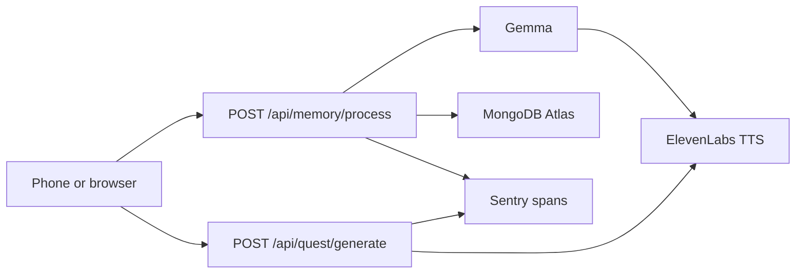

#Little Time Machine

Outdoor nostalgia quests for the Hacktoberfest Open-Source AI Challenge, Week 1 ("Touch Grass"). Each walk offers one specific invitation: a childhood toy, a sports belonging, a book, a playing ground, a route, or a place where the person used to spend time with someone. They come back with a photo and a few written sentences. Gemma, running locally through Ollama, turns that writing into a three-sentence reflection, ElevenLabs narrates it, and MongoDB Atlas keeps the card.

Open weights do the reasoning. The written experience stays on this machine until you choose to store the finished card.

## Architecture



## Prize categories this server actually uses

- Best Use of Gemma — `gemma2:2b` via local Ollama for the reflection
- Best Use of ElevenLabs — narrated quest and narrated reflection
- Best Use of MongoDB Atlas — the memory card
- Best Use of Sentry Agent Tracing — nested spans for Gemma, ElevenLabs, and the Atlas write

## Requirements

- Node.js 20+
- [Ollama](https://ollama.com) with `gemma2:2b` pulled
- An ElevenLabs API key
- A MongoDB Atlas connection string
- A Sentry DSN if you want traces exported (the server still runs without one)

## Setup

```bash
cp .env.example .env
# fill ELEVENLABS_API_KEY and MONGODB_URI

ollama pull gemma2:2b

npm install
npm run dev
```

`npm run build` compiles to `dist/`. `npm start` runs the compiled server.

## Endpoints

### `POST /api/quest/generate`

```bash
curl -s -X POST http://localhost:3000/api/quest/generate \
  -H 'Content-Type: application/json' \
  -d '{"questIntention":"an old cricket ball from when I was 15"}'
```

```json
{
  "questText": "…",
  "audioUrl": "http://localhost:3000/media/tts/<sha256>.mp3"
}
```

### `POST /api/memory/process`

Multipart form fields: `photo` (JPEG or PNG), `questText`, and `experienceText` (1–2000 characters). `experienceText` is what the person wrote about the spot. Empty or whitespace-only text is rejected.

```bash
curl -s -X POST http://localhost:3000/api/memory/process \
  -F 'photo=@spot.jpg' \
  -F 'questText=Find the shaded bench under the elm.' \
  -F 'experienceText=Sat under the tree where I played as a child.'
```

```json
{
  "success": true,
  "memoryCard": {
    "photoUrl": "http://localhost:3000/media/photos/….jpg",
    "experienceText": "Sat under the tree where I played as a child.",
    "reflectionText": "…",
    "reflectionAudioUrl": "http://localhost:3000/media/tts/….mp3",
    "timestamp": "2026-10-11T09:00:00.000Z"
  }
}
```

Errors use `{ "success": false, "error": "…", "code": "…" }` with a 4xx or 5xx status. The uploaded photo is removed when the pipeline fails. Identical narration text is served from a local MP3 cache so a retry does not call ElevenLabs again. Older memory documents that still have a `transcript` field are left in place; new documents store `experienceText`.

`GET /health` returns `{ "ok": true, "service": "memoryquest-ai" }`.

## Tracing

Each pipeline is a Sentry span (`quest.generate` or `memory.process`) with child spans:

| Span | What it measures |
| --- | --- |
| `llm.gemma` | Ollama latency, prompt tokens, completion tokens |
| `tts.elevenlabs` | Speech synthesis latency, cache hit, byte size |
| `db.mongodb` | Atlas insert |

Set `SENTRY_DSN` to export them. Without a DSN the spans stay local and nothing is sent.

## Why the open model is the core

Gemma 2 2B runs on the laptop through Ollama and writes the reflection from the words the person typed. The quest itself is a specific invitation, so the small model cannot replace it with a bench or a tree. The written experience is not sent to a speech-to-text service. ElevenLabs narrates the quest and the reflection. Swap `OLLAMA_MODEL` when you want a different open weight for the reflection.
